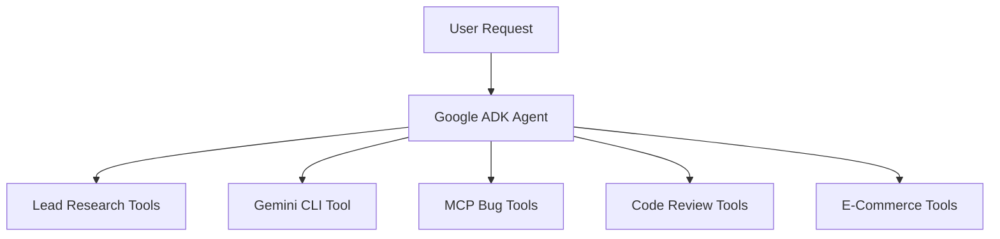

# ADK Production Agent Suite

A multi-agent application built with the Google Agent Development Kit (ADK). This project demonstrates research automation, Gemini CLI integration, MCP tools, code review, and e-commerce workflows.

## Walkthrough Video

🎥 **Complete execution walkthrough:**  
[Watch the YouTube walkthrough](PASTE_YOUTUBE_VIDEO_LINK_HERE)

> After uploading the recording to YouTube as **Unlisted**, replace `PASTE_YOUTUBE_VIDEO_LINK_HERE` with your actual YouTube URL.

## GitHub Repository

[View the source code on GitHub](https://github.com/qwertydgdhegncf/adk-production-agent-suite)

---

## Project Overview

This repository contains five ADK-based agents:

1. Lead Research Agent
2. Gemini CLI Tool Agent
3. MCP Bug Assistance Agent
4. Code Review Assistant
5. E-Commerce Agent

The project also includes automated tests, reusable tools, environment configuration, documentation, and a local MCP server.

---

## Agents

### 1. Deep Research Lead Generation Agent

The lead research agent performs structured research on companies and produces useful lead-generation briefs.

Capabilities:

- Research company information
- Fetch publicly available web pages
- Extract relevant business information
- Identify potential opportunities
- Generate a structured lead brief
- Recommend possible next steps

Location:

```text
apps/lead_researcher/
```

Main files:

```text
apps/lead_researcher/agent.py
apps/lead_researcher/tools.py
apps/lead_researcher/__main__.py
```

Example request:

```text
Research Acme Corporation and prepare a lead-generation brief.
```

---

### 2. Gemini CLI Tool Agent

The Gemini CLI agent demonstrates how an external command-line AI tool can be used inside an ADK pipeline.

Capabilities:

- Delegate analysis tasks to Gemini CLI
- Run repository-focused coding tasks
- Use external CLI output inside an ADK workflow
- Handle command execution errors
- Return structured results to the user

Location:

```text
apps/gemini_cli_agent/
```

Example request:

```text
Use the Gemini CLI to analyze the current project and recommend improvements.
```

The Gemini CLI must be installed and configured separately if this workflow is being executed locally.

---

### 3. MCP Bug Assistance Agent

The bug assistance agent uses a local Model Context Protocol server to provide safe software debugging tools.

MCP capabilities:

- List project files
- Read files safely
- Prevent path traversal
- Analyze reported bug symptoms
- Produce debugging recommendations
- Keep the bug investigation workflow structured

Locations:

```text
apps/bug_assistant/
mcp_server/
```

Main MCP files:

```text
mcp_server/__main__.py
mcp_server/bug_tools.py
```

Example request:

```text
Inspect the project files and help diagnose the authentication error.
```

---

### 4. Production-Oriented Code Review Assistant

The code review assistant checks source code for common reliability and security issues.

Checks include:

- Hardcoded API keys and secrets
- Unsafe shell command execution
- Swallowed exceptions
- Sensitive information in logs
- Reliability concerns
- Maintainability problems
- Suggested improvements

Location:

```text
apps/code_review/
```

Main files:

```text
apps/code_review/agent.py
apps/code_review/tools.py
```

Example request:

```text
Review this Python code for security, reliability, and maintainability issues.
```

---

### 5. Production-Oriented E-Commerce Agent

The e-commerce agent provides a structured shopping and order-preview workflow.

Capabilities:

- Search the product catalog
- Look up product details
- Check product availability
- Calculate cart totals
- Apply supported discounts
- Generate an order preview
- Return structured product information

Location:

```text
apps/commerce/
```

Example request:

```text
Find a laptop under $1,500 and prepare an order preview.
```

> This project does not process real payments or create real customer orders. The order workflow is implemented as a safe preview.

---

## Architecture



---

## Project Structure

```text
adk-production-agent-suite/
├── apps/
│   ├── lead_researcher/
│   │   ├── __init__.py
│   │   ├── agent.py
│   │   ├── tools.py
│   │   └── __main__.py
│   ├── gemini_cli_agent/
│   │   ├── __init__.py
│   │   ├── agent.py
│   │   └── tools.py
│   ├── bug_assistant/
│   │   ├── __init__.py
│   │   └── agent.py
│   ├── code_review/
│   │   ├── __init__.py
│   │   ├── agent.py
│   │   └── tools.py
│   └── commerce/
│       ├── __init__.py
│       ├── agent.py
│       └── tools.py
├── common/
│   ├── __init__.py
│   └── config.py
├── mcp_server/
│   ├── __init__.py
│   ├── __main__.py
│   └── bug_tools.py
├── tests/
│   ├── __init__.py
│   └── test_tools.py
├── docs/
│   ├── SETUP.md
│   └── VIDEO_WALKTHROUGH.md
├── .env.example
├── .gitignore
├── pyproject.toml
└── README.md
```

---

## Requirements

- Python 3.11 or newer
- Google AI API key
- Google Agent Development Kit
- Git
- Optional Gemini CLI installation
- macOS, Linux, or Windows with a compatible Python environment

---

## Installation

Clone the repository:

```bash
git clone https://github.com/qwertydgdhegncf/adk-production-agent-suite.git
cd adk-production-agent-suite
```

Create a virtual environment:

```bash
python3 -m venv .venv
```

Activate the virtual environment on macOS or Linux:

```bash
source .venv/bin/activate
```

Activate the virtual environment on Windows:

```powershell
.venv\Scripts\activate
```

Install the project dependencies:

```bash
pip install -e ".[dev]"
```

---

## Environment Configuration

Create a local environment file:

```bash
cp .env.example .env
```

Update `.env` with your own configuration:

```env
GOOGLE_API_KEY=your_google_api_key_here
GOOGLE_GENAI_USE_VERTEXAI=false
GOOGLE_CLOUD_PROJECT=
GOOGLE_CLOUD_LOCATION=global
ADK_MODEL=gemini-3.7-flash
```

Do not commit the `.env` file to GitHub.

Never publish:

- API keys
- Passwords
- Access tokens
- Service-account credentials
- Private cloud configuration
- Personal information

---

## Running the Agents

Start the lead research agent:

```bash
adk web apps/lead_researcher
```

Start the Gemini CLI agent:

```bash
adk web apps/gemini_cli_agent
```

Start the MCP bug assistance agent:

```bash
adk web apps/bug_assistant
```

Start the code review agent:

```bash
adk web apps/code_review
```

Start the e-commerce agent:

```bash
adk web apps/commerce
```

The ADK web interface can then be used to send prompts to the selected agent.

---

## Example Prompts

### Lead Research Agent

```text
Research Tesla and create a lead-generation brief focused on potential software opportunities.
```

### Gemini CLI Agent

```text
Use the Gemini CLI to inspect this repository and suggest three improvements.
```

### MCP Bug Assistant

```text
List the project files and help diagnose a bug where users cannot log in.
```

### Code Review Assistant

```text
Review this function for security and reliability issues.
```

### E-Commerce Agent

```text
Find wireless headphones under $200 and prepare an order preview.
```

---

## Running the Test Suite

Run all tests:

```bash
pytest -q
```

The tests cover core functionality such as:

- Lead research tool behavior
- Cart total calculations
- Order preview generation
- Code review security checks
- Secret detection
- Safe tool execution

A successful test run should complete without failures.

---

## Code Quality Checks

Compile the Python source files:

```bash
python -m compileall apps common mcp_server tests
```

Check for formatting problems in the Git repository:

```bash
git diff --check
```

Check the current Git status:

```bash
git status
```

---

## MCP Server

The MCP server is implemented in:

```text
mcp_server/
```

It provides tools that can be used by the bug assistance agent.

The MCP server includes protections for:

- Restricted file access
- Unsafe path traversal
- Invalid file requests
- Controlled tool execution

The bug assistant connects to the MCP server through the ADK MCP tool integration.

---

## Gemini CLI Integration

The Gemini CLI agent uses a subprocess-based tool wrapper. The wrapper:

1. Receives a task from the ADK agent.
2. Executes the Gemini CLI command.
3. Captures the command output.
4. Handles errors and timeouts.
5. Returns the result to the ADK workflow.

The Gemini CLI is optional for the rest of the project. The other agents can operate independently.

---

## Security Considerations

This project follows several security practices:

- Secrets are loaded from environment variables.
- `.env` files are excluded from version control.
- MCP file access is restricted.
- Path traversal attempts are rejected.
- Shell execution is reviewed by the code review assistant.
- E-commerce orders are previews only.
- No real payment information is collected.
- No real customer orders are submitted.

Before deploying to production, additional controls should be added, including:

- User authentication
- Authorization
- Rate limiting
- Centralized logging
- Secret Manager integration
- Database persistence
- Monitoring and alerting
- Input validation
- Production deployment configuration

---

## Documentation

Additional documentation is available in:

```text
docs/SETUP.md
docs/VIDEO_WALKTHROUGH.md
```

The walkthrough documentation explains:

- Environment setup
- Agent execution
- Test execution
- Example prompts
- Demonstration flow
- Video recording steps

---

## Assignment Coverage

This repository demonstrates the following requested concepts:

| Requirement | Implementation |
|---|---|
| Deep research lead generation | `apps/lead_researcher/` |
| Gemini CLI inside ADK | `apps/gemini_cli_agent/` |
| MCP tools for bug assistance | `apps/bug_assistant/` and `mcp_server/` |
| Production-oriented code review | `apps/code_review/` |
| Production-oriented e-commerce agent | `apps/commerce/` |
| Automated tests | `tests/` |
| Setup and execution walkthrough | `docs/` |
| Video walkthrough | YouTube link above |

---

## Limitations

This repository is an educational and demonstration implementation.

The following integrations are not enabled by default:

- Real payment processing
- Real order fulfillment
- Production customer database
- GitHub pull-request webhooks
- External enterprise CRM
- Production monitoring
- Cloud Run deployment
- Managed AlloyDB persistence

These components can be added for a full production deployment.

---

## Useful Links

- [GitHub Repository](https://github.com/qwertydgdhegncf/adk-production-agent-suite)
- [Google ADK Documentation](https://google.github.io/adk-docs/)
- [Google Cloud ADK Resources](https://cloud.google.com/vertex-ai/generative-ai/docs/agent-development-kit/overview)
- [Google MCP Documentation](https://modelcontextprotocol.io/)
- [Google Gemini Documentation](https://ai.google.dev/)

---

## Author

Built as a Google ADK multi-agent engineering project demonstrating tool use, MCP integration, AI-assisted development, research automation, and business workflows.

## License

This project is provided for educational and demonstration purposes.
